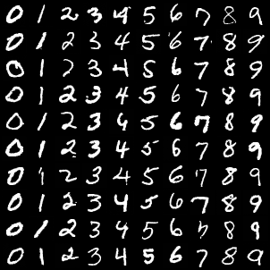
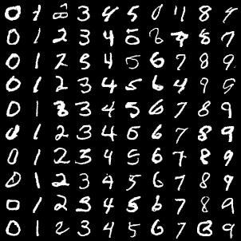
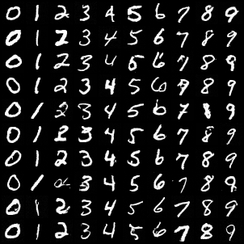
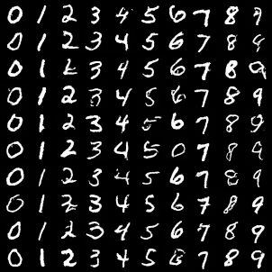
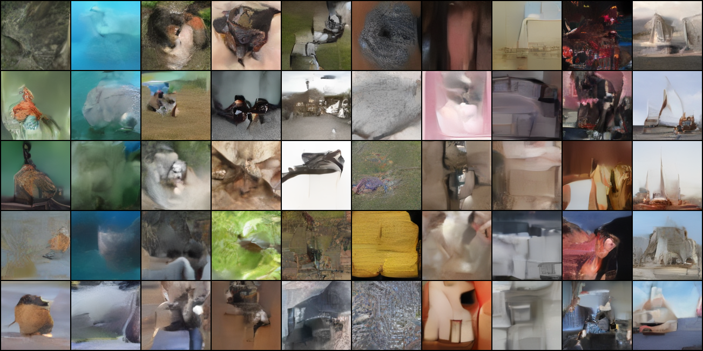
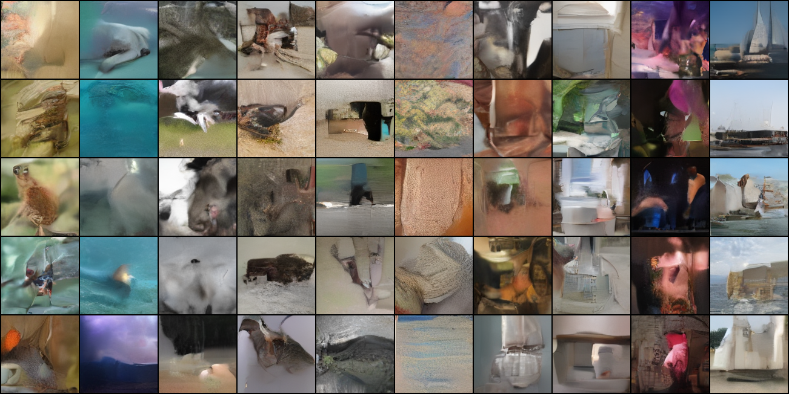
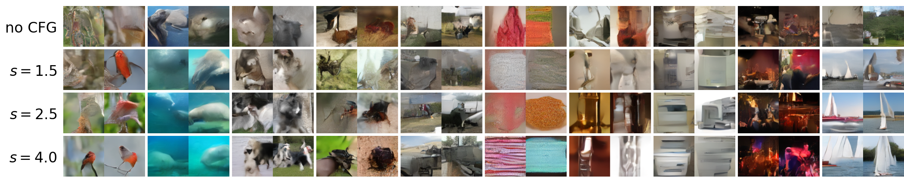

# DDPM vs Rectified Flow with U-Net and ViT

CS 771 (Fall 2026) Homework 3, by Aditya Kumar, Amogh Dixit and Shivam Mittal.

We implement two generative models for class-conditional image generation and compare them:

- **DDPM** (denoising diffusion probabilistic models): the network learns to predict the noise added to an image. Sampling removes noise over 500 steps.
- **Flow Matching with rectified flow (FM)**: the network learns the velocity along a straight line from noise to data. Sampling follows this velocity with 10 Euler steps.

Each model runs with two backbones, a **U-Net** and a **ViT** (LightningDiT, a DiT-style transformer). We train on **MNIST** in pixel space and on **MiniImageNet** (128x128, 100 classes) in the latent space of a frozen pretrained autoencoder (TAESD). As a bonus, we add **classifier-free guidance (CFG)**. Sample quality is measured with FID (lower is better).

The full write-up is in [`writeup/writeup.pdf`](writeup/writeup.pdf).

## What we implemented

| File | Change |
|---|---|
| `code/libs/unet.py` | U-Net decoder: skip-connection concat, ResBlock, cross-attention, upsampling |
| `code/libs/vit.py` | ViT forward pass: time + class conditioning vector, DiT blocks with adaLN-Zero, unpatchify |
| `code/libs/ddpm.py` | DDPM loss (noise MSE), reverse step (Eq. 11 of the DDPM paper), full sampler, latent mode, CFG |
| `code/libs/fm.py` | Rectified flow loss (velocity MSE, t ~ U[0,1]), Euler sampler, latent mode, CFG |
| `code/eval.py` | Flags `--no-cfg`, `--cfg-scale`, `--cfg-start-t` to control guidance at evaluation time |

Latent mode (`use_vae: True`) encodes images with the frozen TAESD encoder during training, so the network works on 4x16x16 latents instead of 3x128x128 pixels. Generated latents are decoded back to images at the end.

## Results

### MNIST (30 epochs, A100)

| Model | Backbone | Params | Sampling steps | FID |
|---|---|---|---|---|
| DDPM | U-Net | 7.46M | 500 | **8.19** |
| DDPM | ViT | 5.50M | 500 | 10.16 |
| FM | U-Net | 7.46M | 10 | 14.01 |
| FM | ViT | 5.50M | 10 | 12.08 |

DDPM gives the best FID, but FM samples 50x faster (10 network calls instead of 500) for a small loss in quality.

| DDPM U-Net | DDPM ViT | FM U-Net | FM ViT |
|---|---|---|---|
|  |  |  |  |

### MiniImageNet, latent FM (80 epochs, L4)

| Backbone | Params | Train time | FID (no CFG) | FID (CFG, s=4) |
|---|---|---|---|---|
| U-Net | 16.77M | 1.95 h | 119.1 | 66.9 |
| ViT | 18.35M | 2.38 h | 115.1 | **57.9** |

Without guidance, samples show class-consistent colors and scenes but few clear objects. This is expected with this small training budget.

| U-Net (no CFG) | ViT (no CFG) |
|---|---|
|  |  |

### Bonus: classifier-free guidance

CFG needs no retraining. FID improves steadily with the guidance scale s:

| Backbone | No CFG | s=1.5 | s=2.5 | s=4.0 |
|---|---|---|---|---|
| U-Net | 119.1 | 102.4 | 79.4 | 66.9 |
| ViT | 115.1 | 98.6 | 72.3 | **57.9** |

Higher scales make samples sharper and clearly match their class, but samples within a class become less diverse.



All FID outputs are in [`results/fid_results.txt`](results/fid_results.txt). Full-size sample grids are in [`results/`](results/).

## Repository layout

```
code/            training, evaluation, models and configs
  configs/       one YAML file per experiment
  libs/          models (ddpm.py, fm.py), backbones (unet.py, vit.py), blocks, data, FID
pretrained/      TAESD encoder and decoder weights
writeup/         report (PDF and LaTeX source) and its figures
results/         FID log and full-size sample grids
colab_run.ipynb  notebook used to train and evaluate everything on Google Colab
```

## How to run

All commands run from `code/`.

```bash
pip install -r requirements.txt

# train (datasets download automatically, outputs go to ../logs/<config>_final)
python train.py configs/mnist_ddpm_unet.yaml --output final

# evaluate FID without guidance
python eval.py configs/mnist_ddpm_unet.yaml ../logs/mnist_ddpm_unet_final --no-cfg

# evaluate with CFG at a chosen scale
python eval.py configs/miniimagenet_fm_vit.yaml ../logs/miniimagenet_fm_vit_final --cfg-scale 4.0
```

Available configs: `mnist_{ddpm,fm}_{unet,vit}.yaml` and `miniimagenet_fm_{unet,vit}.yaml`.

Resume an interrupted run with `--resume ../logs/<run>/epoch_XXX.pth.tar`. Watch training curves with `tensorboard --logdir ../logs`.

## References

- Ho et al., Denoising Diffusion Probabilistic Models, NeurIPS 2020
- Liu et al., Flow Straight and Fast: Rectified Flow, ICLR 2023
- Peebles and Xie, Scalable Diffusion Models with Transformers (DiT), ICCV 2023
- Yao et al., LightningDiT, CVPR 2025
- Rombach et al., Latent Diffusion Models, CVPR 2022
- Ho and Salimans, Classifier-Free Diffusion Guidance, 2022
- TAESD: https://github.com/madebyollin/taesd
